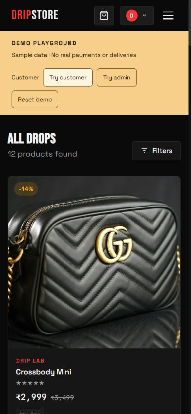
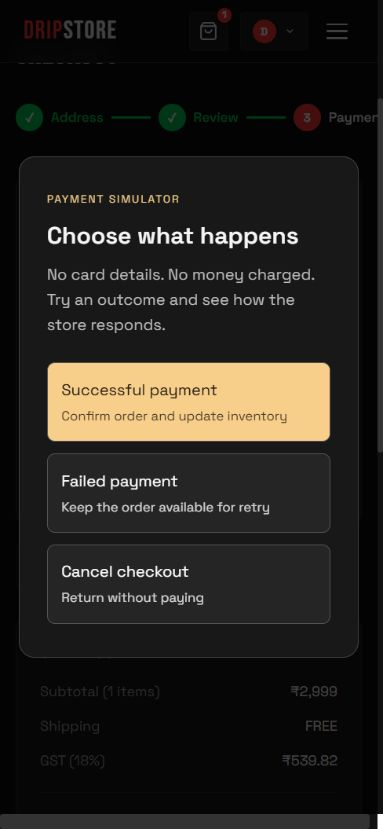
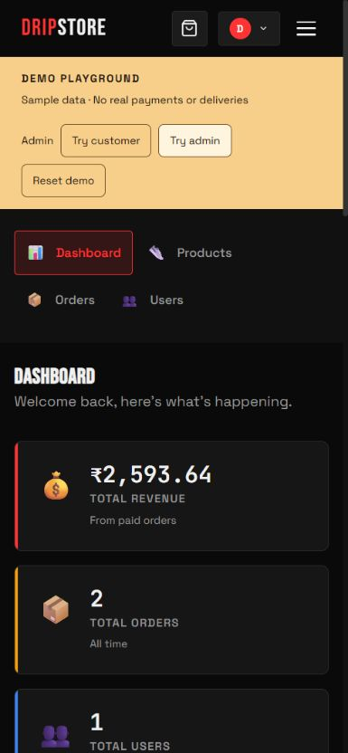

# DripStore


React storefront and Express/MongoDB API for sneakers and streetwear. Includes guest carts, customer accounts, catalog filters, Razorpay checkout, payment recovery, and product/order administration.

## Portfolio demo (no credentials)

After installing the three dependency sets below, run from the repository root:

```sh
npm run demo
```

Open http://localhost:3000. Keep ports 3000 and 5000 free. The first launch may download a MongoDB binary; wait for the **DEMO API ready** message.

- **Try customer**: browse 12 sample products with locally bundled stock photos, choose a size, add to cart, and use the sample shipping address.
- **Simulate payment**: choose success, failure, or cancellation. Successful payments update real demo inventory; failed/cancelled attempts remain retryable from My Orders.
- **Try admin**: explore dashboard revenue, sample order history, inventory, product edits, and fulfillment. Demo image uploads are stored in the temporary database (maximum 1 MB per image).
- **Reset demo**: restore the catalog, two paid sample orders and one pending order. The current role stays signed in; other sessions expire.

This is one shared local playground, not a separate workspace per visitor. No real money is charged and no orders are delivered. The dedicated launcher creates its own disposable MongoDB replica set, ignores server .env/MONGO_URI, and generates a fresh session secret. The frontend demo command fixes its API target to that local server. Razorpay SDK, payment verification, and webhooks are disabled in demo mode; Cloudinary is not used.

Ctrl+C stops the demo. Restarting starts fresh. Demo shortcuts and reset/payment endpoints are unavailable when using the normal server command. A Docker/Render hosting configuration is prepared. See [Render deployment](RENDER_DEPLOYMENT.md); no public deployment has been completed.

## Requirements (normal development)

- Node.js 24 recommended (minimum 22.12).
- MongoDB Atlas or a local **replica set**. Standalone MongoDB cannot run the payment transactions.
- Cloudinary account and Razorpay test keys.
- A distinct Razorpay webhook secret.

## Setup

Install reproducibly from the repository root:

```sh
npm ci
npm ci --prefix server
npm ci --prefix client
```

Copy `server/.env.example` to `server/.env` and `client/.env.example` to `client/.env`. Fill in credentials locally; never commit them. Start both applications:

```sh
npm run dev
```

The storefront runs on port 3000. Its Vite development proxy forwards `/api` to port 5000. The API validates required settings and database transaction support before listening.

Production client variables retain the `REACT_APP_*` names for compatibility. Vite exposes only the explicit public settings listed in `client/vite.config.mjs`; changing them requires rebuilding. `REACT_APP_API_URL` must include `/api` when using a separate API host.

## Verification

```sh
npm test
npm run lint
npm run build
npm audit
npm audit --prefix server
npm audit --prefix client
```

Backend tests launch their own disposable MongoDB replica set and use synthetic payment responses. They do not load the project `.env`, contact the real payment provider, or modify an existing database. The first run downloads a MongoDB binary. Frontend tests use Vitest and jsdom. CI runs tests, lint, build, and audits.

## Payments and refunds

1. The API constructs immutable order items and totals from catalog records.
2. Checkout creates a provider order bound to the authenticated customer and store order.
3. Browser verification or a signed webhook fetches the payment from Razorpay.
4. The API verifies provider order, amount, currency, and captured status.
5. A database transaction records payment and deducts inventory exactly once.
6. If stock is unavailable, the order becomes **Payment Review**, with **refund required**. It is not fulfilled.

Inventory is allocated after capture. Concurrent buyers can therefore produce a captured payment requiring a refund. Staff must monitor the refund queue and issue refunds in Razorpay Dashboard; the app does **not** automatically send refunds.

Configure a public HTTPS webhook at `/api/payment/webhook` for `payment.captured`, `order.paid`, and `refund.processed`. Use the exact secret stored in `RAZORPAY_WEBHOOK_SECRET`. The handler verifies the raw request bytes. Configure payment capture in Razorpay Dashboard and test the complete test-mode flow before enabling live payments.

Closing checkout keeps the order retryable. Customers can use **My Orders → Check payment status** to reconcile an interrupted callback. The order history also exposes pending attempts.

Cancellation restores deducted inventory once and marks captured payments for refund. Only a fully processed refund clears the queue. Current workflow supports cancellation before shipping; post-shipment returns remain a separate feature.

## Inventory and administration

Existing products retain pooled stock across sizes. The product editor can enable per-size inventory without guessing historic stock allocation. The sum of size quantities must equal total stock.

Register normally, then assign the first administrator deliberately through your database administration tool. Admin routes enforce server-side authorization. Order transitions are restricted and include actor/time history.

Product images accept JPG, PNG, and WEBP up to 5 MB each, with at most five images per product. New uploads retain Cloudinary public IDs for cleanup. Legacy image URLs without saved public IDs require a separate reviewed cleanup; the API does not guess IDs or delete unrelated assets.

## Development seeding

The seeder deletes all store records in its selected database. It runs only with all three safeguards:

- `NODE_ENV=development`.
- `SEED_DATABASE_NAME` exactly matches the URI database and ends in `_dev` or `_test`.
- Explicit `--allow-delete`.

```sh
npm run seed --prefix server -- --allow-delete
```

Never run this against production. Demo credentials are for this disposable development database only.

## Deployment

Build the frontend with `npm run build`; deploy `client/build` as static files. Configure the host to rewrite application routes to `/index.html`, while forwarding `/api` to the API if both share a domain. Run the backend with `npm start --prefix server`.

Set `NODE_ENV=production`, a strong JWT secret, exact HTTPS `CLIENT_URL`, credentials, and webhook configuration. Set `TRUST_PROXY_HOPS` only when the proxy topology is fixed and trusted. Rate limits are per process; use a shared gateway limiter for multiple instances.

- Liveness: `GET /api/health`.
- Database readiness: `GET /api/ready`.
- Structured request/error logs include a request ID.
- SIGTERM/SIGINT drain the API and disconnect MongoDB.

For the disposable portfolio demo, use the [Render deployment guide](RENDER_DEPLOYMENT.md).

Support email and approved policy links are optional public client settings. Supply genuine business details before launch. The application omits unconfigured legal links and unsupported storefront claims.

## Current limits

Docker/Render hosting files are prepared. Mobile checkout, admin editing/upload/re-editing, and order fulfillment were browser-checked on 2026-10-11. The production-style local server passes routing/assets/readiness checks; Linux container validation, Render deployment, and public HTTPS checks are pending. Real Razorpay and Cloudinary are outside the portfolio demo checks. Wishlist, coupons, password recovery/email verification, transactional email, carrier tracking, and post-shipment returns are not included in this repair release.

## Demo photo credits

Demo product photos are bundled locally under `client/public/demo/products`. See [image credits](client/public/demo/products/CREDITS.md) for source URLs and license. Product names and prices are fictional portfolio data; stock photos are illustrative.

## Demo screenshots

Captured during the 390 × 844 mobile check. Live URL: not deployed yet.

| Catalog | Payment simulator | Admin dashboard |
| --- | --- | --- |
|  |  |  |

## Desktop screenshots


## Author

[Avi Mishra](https://github.com/avimishra25) — Ahmedabad, India.
